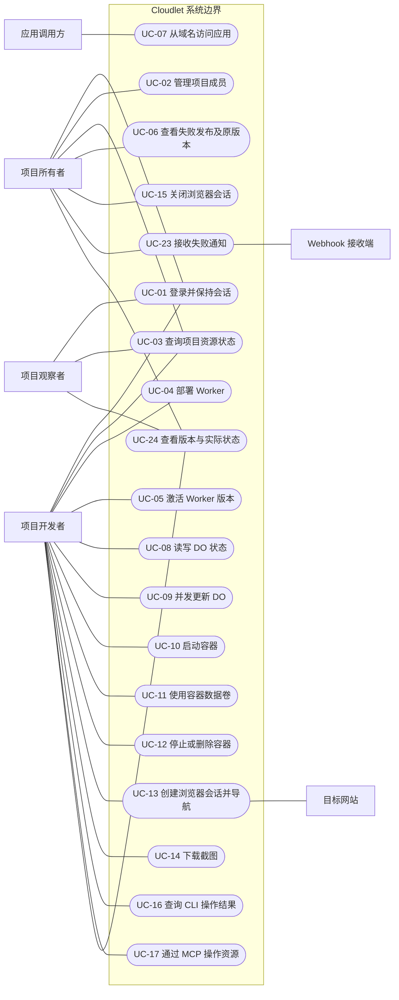

# 第 3 课需求规约

状态为课前评审稿。教师评审通过并签字后建立 SRS v1.0 基线。关联 [第 3 课任务 #65](https://github.com/wendaining/cloudlet/issues/65)。

## 业务问题与项目目标

个人开发者和小型团队在单台服务器上运行应用时，部署流程分散在多个工具中，各应用之间缺少权限隔离，进程退出后缺少自动恢复手段。调研报告 F1 至 F6 记录了这些问题的设计依据和待验证假设，真人访谈及干系人确认结果待记录。

Cloudlet 的目标是为这类场景提供统一的项目授权、应用发布、运行状态查询和外部访问能力。范围依据[第 1 课调研报告](lesson-01-requirements-research.md#五调研发现)和[第 2 课用户故事](lesson-02-user-stories.md)。

| 增量 | 可交付能力 |
| --- | --- |
| 基础管理 | 登录、项目成员授权和资源状态查询 |
| 运行能力 | Worker 发布、DO 持久化、容器运行、浏览器会话和 Gateway 访问 |
| 自动化与恢复 | CLI、MCP、Webhook、管理界面、并发准入和故障恢复 |

## 参与者与权限

| 参与者 | 职责与权限 |
| --- | --- |
| 项目所有者 | 管理成员、权限与项目资源，核对容量和故障恢复结果 |
| 项目开发者 | 发布应用、激活版本、操作容器、绑定 DO、执行浏览器任务和查询操作 |
| 项目观察者 | 查看获授权的资源、状态、日志与产物 |
| 应用调用方 | 从公开域名发起 HTTP 请求，并根据响应判断访问结果 |
| Webhook 接收端 | 接收并验证 Cloudlet 推送的运行事件 |

前三类属于项目成员角色。自动化调用使用项目授权，CLI、MCP 与管理界面沿用相同的权限范围。Webhook 接收端是通知用例的次要参与者。浏览器导航的目标站点是浏览器任务的次要参与者。

干系人覆盖按使用、管理、维护、付费和监管五个维度检查。使用维度由开发者、观察者和调用方覆盖。管理和付费由项目所有者承担。维护通过容量预算（NFR-05）和控制器恢复（NFR-02、NFR-03）间接满足。监管由 Webhook 通知（UC-23）和管理界面状态比对（UC-24）支撑。

## 用例图

图中的编号对应功能用例。项目所有者可操作本项目中的全部资源。安全、容量和可用性要求通过相应的质量验证场景追溯。

## 功能需求

每条需求的完整 Given、When、Then 保存在[对应的用户故事 Issue](lesson-03-traceability.md)。下表列出评审中可以观察的结果。

| 需求 ID | 用例 | 描述与验收标准 |
| --- | --- | --- |
| FR-01 | UC-01 | 启用账号使用正确凭据后建立 HttpOnly 会话，刷新页面后保留账号和项目权限。错误密码返回 401。 |
| FR-02 | UC-02 | 所有者可为已有账号设置项目角色。开发者无权修改角色，观察者仅可读取。 |
| FR-03 | UC-03 | 授权项目返回目标状态、实际状态和最近操作。跨项目查询被拒绝，响应不泄露该项目详情。 |
| FR-04 | UC-04 | 接收有效模块包、绑定和兼容配置，保存不可变版本。真实 workerd 执行就绪后，项目域名可以返回活动 Worker 的结果。 |
| FR-05 | UC-05 | 开发者激活已就绪的新版本后，新请求访问新版本，域名保持不变。重复提交返回相同操作结果。 |
| FR-06 | UC-06 | 候选版本预检或就绪失败时，记录失败原因。原活动版本继续处理公开请求。 |
| FR-07 | UC-07 | 已知域名将请求转发给应用。未知域名返回 404，无法连接上游时返回 502。 |
| FR-08 | UC-08 | 同一对象标识可以读取已提交的值。其他对象及未提交的事务数据不可见。 |
| FR-09 | UC-09 | 并发执行增量后，最终计数等于成功请求数。其他对象及项目的状态保持原值。 |
| FR-10 | UC-10 | 接收有效镜像摘要、端口、配额和数据卷声明后，启动真实容器。就绪后从项目域名取得容器的预期响应。 |
| FR-11 | UC-11 | 挂载已声明的数据卷写入数据，停止并再次启动后仍能读取。可写数据卷只有一个执行实例持有写权限。 |
| FR-12 | UC-12 | 停止时撤销公开访问并释放执行资源。确认删除数据卷后，删除操作移除容器及声明的数据卷。 |
| FR-13 | UC-13 | 在凭据有效且容量充足时创建真实 Chromium 会话。导航后返回与实际页面一致的地址和标题。 |
| FR-14 | UC-14 | 截图后生成 PNG 产物。授权用户下载的内容、大小和摘要与产物记录一致，未授权项目无法读取。 |
| FR-15 | UC-15 | 会话到期或开发者关闭会话后，Chromium 和容器退出。记录终态并释放容量。 |
| FR-16 | UC-16 | CLI 从管理 API 查询 Operation。成功与失败分别返回文档约定的退出码。 |
| FR-17 | UC-17 | MCP 客户端使用项目凭据查询资源并发起部署，获得资源和 Operation 标识，后续可查询同一终态。 |
| FR-18 | UC-23 | 部署失败、执行异常退出或容量耗尽时，授权配置的 HTTPS 接收端收到带签名的 JSON 事件。签名和事件标识可验证，重试结果可查询。 |
| FR-19 | UC-24 | 活动版本、目标状态、实际状态和最近操作分别展示，状态不一致时仍可区别两类状态。 |

## 非功能需求

| 需求 ID | 场景 | 类别 | 条件与通过标准 |
| --- | --- | --- | --- |
| NFR-01 | UC-18 | 安全 | 两个项目分别运行应用并持有数据。使用项目 A 的凭据访问项目 B 的管理或执行资源时，跨项目访问全部被拒绝，网络、挂载、数据和 Secret 保持隔离。 |
| NFR-02 | UC-19 | 可恢复性 | 产物保存后、激活前终止控制器，再启动并核对实际执行。原版本继续服务，候选执行完成接管或清理，Operation 到达明确终态。 |
| NFR-03 | UC-20 | 可用性 | 容器运行期间持续通过 Gateway 发起请求并重启管理控制器。恢复后接管原容器且无重复实例，公开请求在测试期间继续取得预期结果。 |
| NFR-04 | UC-21 | 数据持久性 | 保存对象数据后执行兼容版本交接。相同对象标识读到原值。迁移失败时保留旧版本和原存储。 |
| NFR-05 | UC-22 | 性能与容量 | 在四核四 GiB 主机上，扣除固定服务预算，将已有预留推至可用容量边界，再并发申请剩余容量。总预留始终在预算内，超额申请不启动实例，清理确认后容量可再次使用。 |

NFR-05 的性能验收条件：在四核四 GiB 主机上，稳定运行的真实 Worker 经 Gateway 接收 20 路并发请求，持续 60 秒，95 百分位响应时间在 500 毫秒内，成功率至少 99%。测试记录硬件配置、请求负载、响应体大小和实际延迟分布，确认后纳入基线。

## 核心场景

### UC-02 管理项目成员

前置条件为项目存在，所有者已登录，受邀账号已启用。

| 步骤 | 参与者操作 | 平台行为与验证结果 |
| --- | --- | --- |
| 1 | 所有者选择账号与项目角色并提交 | 平台核对所有者权限并持久化角色配置 |
| 2 | 受邀账号发起项目访问请求 | 平台加载最新项目权限并开放对应操作能力 |
| 3 | 观察者或开发者尝试越权变更角色 | 平台拒绝请求并维持原权限，操作记录可查 |

开发者提交角色修改时，平台拒绝操作并保留现有角色。观察者尝试创建资源时，平台拒绝请求。访问其他项目时不返回目标项目详情。

### UC-04 和 UC-05 发布并激活 Worker

前置条件为开发者已获项目授权，目标项目拥有可用的配额、域名和活动版本 A。

| 步骤 | 参与者操作 | 平台行为与验证结果 |
| --- | --- | --- |
| 1 | 开发者提交候选版本 B 代码包与绑定配置 | 平台校验配置完整性与资源预算，保存不可变部署实体 |
| 2 | 平台调起真实 workerd 运行时实例 | 执行环境完成就绪探测，记录候选版本状态 |
| 3 | 开发者下达版本激活指令 | 平台更新路由表并切换流量至版本 B，保持原有公开域名不变 |
| 4 | 应用调用方发起业务 HTTP 请求 | Gateway 命中新路由并返回版本 B 的处理结果 |

候选版本无法就绪时，操作记录包含失败原因，域名继续访问 A。重复激活同一版本时，返回已确认的结果。容量不足时拒绝启动候选执行。

### UC-10 和 UC-11 运行带数据卷的容器

前置条件为开发者已获项目授权，镜像摘要、端口和数据卷声明有效。

| 步骤 | 参与者操作 | 平台行为与验证结果 |
| --- | --- | --- |
| 1 | 开发者提交容器启动请求与挂载声明 | 平台核对镜像摘要、端口与主机可用配额 |
| 2 | 平台调起真实 Docker 容器并执行就绪检查 | 容器健康后 Gateway 绑定路由并放行外部访问 |
| 3 | 容器内进程写入数据至已声明数据卷 | 容器停止后重新调起，持久化数据依然完整可读 |

端口或镜像配置无效时，平台报告错误。容量不足或已有其他执行持有同一可写数据卷时，平台拒绝新申请。

## 外部集成

Webhook 是本项目的外部集成点（UC-23、FR-18）。部署失败、执行异常退出或容量耗尽时，平台向项目配置的 HTTPS 端点推送带签名的 JSON 事件。接收端验证签名和事件标识，查询重试状态。集成验证使用真实 HTTPS 端点接收并校验事件签名。

## 技术风险

| 风险 | 影响 | 当前对策 | 验证方式 |
| --- | --- | --- | --- |
| 四核四 GiB 主机同时运行 Worker、容器和浏览器会话，容量争用可能导致资源申请失败或已有应用性能下降 | 可用容量不可预测，用户部署被拒绝 | 申请前扣减固定预算，超额请求拒绝启动（NFR-05） | 在目标硬件上并发申请资源，记录延迟和成功率 |
| Worker 升级时 Durable Object 数据迁移失败，导致业务状态丢失 | 用户已存储的对象数据无法读取 | 迁移失败时保留旧版本和原存储（NFR-04） | 版本交接后验证对象数据读取一致性 |

## 约束与验证

平台目标环境为单台 Linux 主机。授权按项目生效，浏览器会话与执行实例占用项目和环境预算。Webhook 通过允许访问的 HTTPS 端点验证。

功能验收使用真实数据库、workerd、Docker、Chromium 和实际 HTTP 请求。性能目标、访谈结论及教师评审状态以实际记录为准。

| 课程规模要求 | 下限 | 本项目实际 |
| --- | --- | --- |
| 可交付增量 | 3 | 3（基础管理、运行能力、自动化与恢复） |
| 用例数量（含非功能需求用例） | 20（含 2） | 24（含 5） |
| 用户角色 | 3 种 | 3 种项目角色加 2 类外部参与者 |
| 外部集成点 | 1 | 1（Webhook 通知） |
| 技术风险点 | 1 | 2（容量争用、DO 数据迁移） |

## 评审、发布与变更

教师逐项确认需求完整、可测试且前后一致，签字后将规约、用例图、[追溯矩阵 v0](lesson-03-traceability.md)和变更记录纳入课程基线。GitHub Release 标题使用 SRS v1.0。

需求变更先建 Issue，记录变更理由、受影响的需求与用例、来源和验收标准。经人工确认后，通过 PR 修改规约及追溯矩阵，记录评审结论，并在发布时附上变更记录。

| 版本 | 状态 | 变更 |
| --- | --- | --- |
| 课前评审稿 | 待教师评审 | 将 24 条用户故事整理为功能与非功能需求，补充用例图、场景和追溯关系。 |
